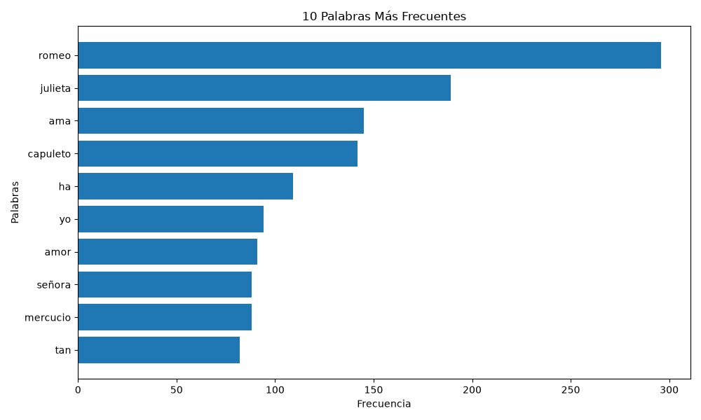
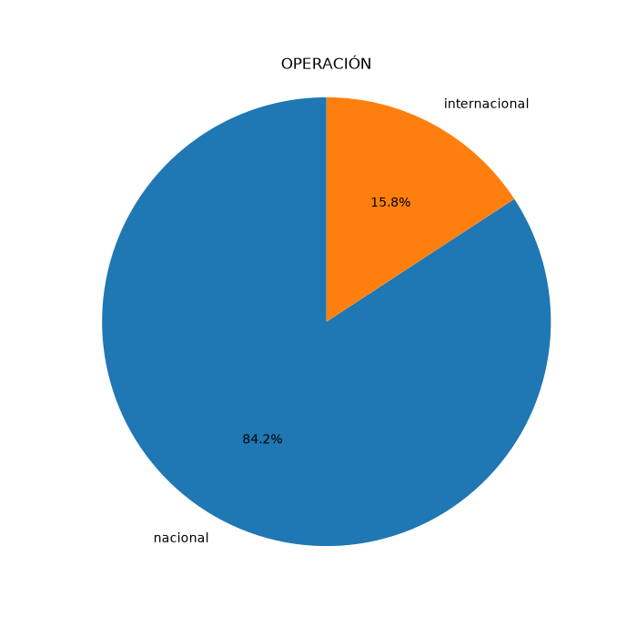
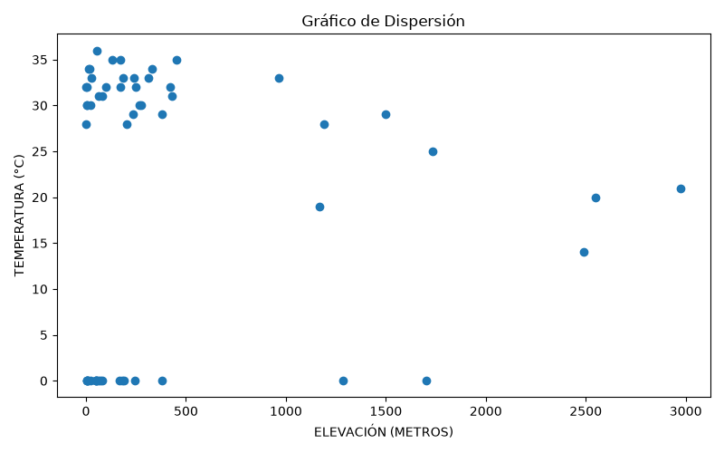

# Documento de Análisis

## Descripción de los datos utilizados

### 1. Archivo de texto: Romeo y Julieta

Se utilizó el archivo **RomeoyJulieta.txt**, que contiene la obra literaria *Romeo y Julieta* escrita por William Shakespeare. Este archivo fue seleccionado para realizar análisis de texto, incluyendo conteo de palabras, caracteres, palabras más frecuentes y conteo de la longitud de las líneas.  
Representa una obra literaria clásica que permite estudiar patrones de escritura, frecuencia de palabras y características generales del texto.  

### 2. Archivo CSV: satena.csv

Se utilizó el archivo **satena.csv**, que contiene información de aeropuertos operados por SATENA en Colombia.

Entre los datos incluidos se encuentran:

- Ciudad
- Departamento
- Operación
- Elevación en pies y en metros
- Temperatura
- Latitud
- Longitud

Representa información geográfica y operativa de diferentes aeropuertos, lo que permite realizar análisis estadísticos y generar visualizaciones gráficas sobre los datos.

# Conclusiones obtenidas a partir de los gráficos

## Conclusión 1

Al analizar el gráfico de palabras más frecuentes del archivo *Romeo y Julieta*, se observó que los nombres de los personajes principales aparecen repetidamente, lo que demuestra que gran parte de la historia gira alrededor de los personajes prinicpales , igualmente se evidencia la palabra amor como una de las mas frecuentes, sabieendo el tema principal de la obra.

## Conclusión 2

En el gráfico de pastel del archivo CSV se observó que la mayoría de los aeropuertos registrados corresponden a operaciones nacionales, mientras que una menor proporción corresponde a operaciones internacionales.

## Conclusión 3

El gráfico de dispersión entre **Elevación** y **Temperatura** permite observar una tendencia donde los aeropuertos ubicados a mayor altura suelen presentar temperaturas más bajas que aquellos ubicados a menor elevación.

